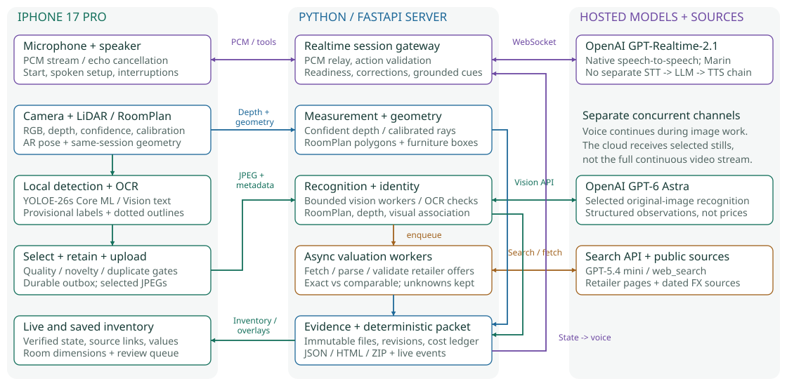

# Library Contents Claim Agent

A native iPhone camera/LiDAR and live-voice client with a local Python service. It saves evidence during one continuous sweep, builds a live evidence-backed inventory, retrieves supported sale offers and computes a traceable JSON/HTML claim packet.

## Assessment submission - 20 October 2026



The iPhone performs provisional object detection, OCR, capture selection and AR/LiDAR acquisition. The server coordinates independent voice, recognition, measurement and pricing work, maintains physical identities, and builds the evidence-backed inventory. Continuous video remains on the phone; selected still frames and calibrated depth are uploaded. See the [one-page architecture](output/pdf/architecture-note.pdf), [full technical report](output/pdf/technical-report.pdf), and [editable diagrams](docs/submission/architecture.mmd).

| Deliverable | Location | Evidence status |
|---|---|---|
| Code and setup | This repository; instructions below | Python, Swift and unsigned iPhone build checks pass |
| Two original recordings | [Submission release](https://github.com/Tushar-kalsi-virtualfusion/cozmo-library-claim-agent/releases/tag/assessment-2026-10-20) | Unedited capture plus separate inventory walkthrough; capture has no audio track |
| Claim packet and report | [JSON](submission/evidence/current/claim_packet.json), [HTML](submission/evidence/current/report.html), [evidence manifest](submission/evidence/current/manifest.json) | Partial saved sweep; 3 book records and 76 item records, not a ground-truth count |
| Ground truth and results | [Workbook](submission/ground-truth-and-results.xlsx), [results and limitations](docs/submission/results.md) | System observations populated; independent physical truth is missing |
| Architecture | [One-page PDF](output/pdf/architecture-note.pdf), [detailed PDF](output/pdf/technical-report.pdf) | As-built hybrid architecture and coordination |
| Failure log | [One-page PDF](output/pdf/failure-log.pdf), [source](docs/submission/failure-log.md) | Root causes, fixes, partial costs and stage latency |

Read [submission status](docs/submission/submission-status.md) before evaluating. This is a partial assessment submission: it does not establish the required 60-book/two-shelf coverage or accuracy pass bars. At packaging time, further pricing was blocked by `credit_balance_exhausted`. The repository is public at the owner's request; the brief requested private sharing. No API keys, pairing configuration, or raw conversation transcripts are included in the submission evidence.

**Current stack (October 20):** OpenAI-only: GPT-Realtime-2.1 streams conversation and speech, GPT-6 Astra reads images, and GPT-5.4 Mini discovers retailer sources. Live voice and Responses access passed earlier probes; a short voice probe delivered first audio in 1.084 seconds after response creation. This is server timing, not measured iPhone latency or a guarantee of current API credit. LiDAR remains automatic when supported, with camera fallback otherwise. See [fresh submission validation](docs/submission/validation.md) and [physical validation](docs/setup/iphone-validation.md).

## Prerequisites

- Mac with Python 3.12 and network access. `uv` is optional; ordinary `venv`/pip works.
- Xcode 26.6 (verified here) or a compatible newer release, an Apple signing team, Developer Mode, and an ARKit-supported iPhone. LiDAR/comparison mode requires a LiDAR iPhone (the planned device is iPhone 17 Pro). The installed toolchain must support the phone's iOS. Xcode download/signing setup is outside the 15-minute repository setup target.
- Microphone permission and network access are required for OpenAI Realtime voice. Apple Speech packs and Apple Intelligence are not required.
- An OpenAI API key with model access and credits is required. Keys stay on the Mac. OpenAI mode does not call Claude or ElevenLabs.
- Phone and Mac on the same trusted Wi-Fi. No public hosting, tunnel or inbound port-forwarding is needed.

## Start the service

```sh
python3.12 -m venv .venv
.venv/bin/python -m pip install -r requirements.lock
cp .env.example .env
chmod 600 .env
```

Put your key in `.env` as `OPENAI_API_KEY=...` with `CLAIM_PROVIDER=openai`,
`CLAIM_VISION_MODEL=gpt-6-astra`, `CLAIM_LIVE_MODEL=gpt-realtime-2.1` and
`CLAIM_CLOUD_VOICE=true`. For an existing installation, preserve its `.env`. Credentials stay on the Mac in the
ignored `.env` (0600). Existing Claude/ElevenLabs credentials are not used in
OpenAI mode. Health describes configuration; successful live requests are needed
to prove model access and credit.

For the iPhone, set `CLAIM_HOST=0.0.0.0` in `.env` so the server continues listening when the Mac's Wi-Fi address changes. Set `CLAIM_PHONE_HOST` to the output of `scutil --get LocalHostName` followed by `.local` (for example, `My-Mac.local`). The phone and Mac must use the same local network. Then start:

```sh
.venv/bin/python -m claim_agent
```

The terminal prints a temporary pairing code. Run `.venv/bin/python scripts/configure_ios.py` to copy only the phone-facing host, port and pairing token into ignored `ios/LocalConnection.xcconfig` (mode 0600), then rebuild the app. `CLAIM_PHONE_HOST` overrides the server bind address only for the phone; existing configurations still use `CLAIM_HOST` when this override is absent. The provider key stays on the Mac. Use the phone’s **Open full review on this phone** link to pair the browser without typing; the review page does not supply metric scale itself. The optional reference demo uses a separate port (4177).

By default the service binds localhost. For the phone, use the wildcard bind and stable local hostname described above. Pairing is a temporary demo boundary, not an authentication product; HTTP on Wi-Fi is unencrypted. Keep the server local. Health checks disclose configuration status, never provider keys or pairing tokens.

## Run on the iPhone

1. Open `ios/LibraryClaim.xcodeproj` in Xcode. Select **LibraryClaim → Signing & Capabilities**, choose your team and adjust the bundle ID if needed.
2. Connect and trust the iPhone, enable Developer Mode, select the physical phone as the run destination and run. The project bundles a YOLOE-26s prompt-free Core ML model with its native 4,585-category vocabulary; its provenance and AGPL-3.0/enterprise license are recorded in `ios/LibraryClaim/Models/README.md`. No package-manager installation is needed. `scripts/generate_xcode_project.py` can recreate the project while preserving the signing team.
3. Generate local connection settings with `.venv/bin/python scripts/configure_ios.py` before building. Tap **Start** and grant Camera, Microphone and Local Network access. Start disappears immediately when pressed, and voice setup begins automatically. A failed connection exposes Try again. There are no address, pairing, language or country input forms.
4. The camera preview and provisional on-phone dotted outlines open before setup; evidence recording waits for readiness. Answer the agent aloud with your preferred language and pricing country/currency. LiDAR is selected automatically when supported, with camera fallback otherwise. Hear the complete read-back, explicitly confirm, then answer the separate readiness question. Voice streams in both directions with echo cancellation. Speak to interrupt, or use **Interrupt & speak** to stop playback explicitly. Sweep all shelf levels and stacks, objects, floor edges and corners in one pass. The assistant can request a clearer or wider view during that pass; never remove books or scan them one by one.
5. End the sweep. Keep the app open until uploads and RoomPlan processing finish. Use **Save or share claim packet**, or open the browser review. Confirm art is a print only when the owner actually says so. Other art/rare/signed objects need appraisal.

**Saved inventories** opens earlier real captures without resuming their camera session. Prices refresh while that view is open. Eligible records with no prior valuation are queued once; unidentified objects and ambiguous earlier searches are not assigned estimates.

The phone retains every selected RGB/calibration/depth payload under Files → On My iPhone → Library Claim → Captures. Interrupted uploads retry; acknowledged files remain retained. Finish waits for pending evidence. Review the [physical-device checklist](docs/setup/iphone-validation.md) before scoring anything.

## Camera and LiDAR comparison

Camera-only mode captures RGB/calibration/OCR without depth or RoomPlan. It can identify visible books and objects. Bounded calibrated overlap and image correspondence can link some repeat views, but do not provide general physical association or monocular metric reconstruction. Dimensions and room area remain unknown; counts can still include repeat views. This is a limitation of this implementation, not a claim about all camera systems.

The optional comparison workflow starts from a LiDAR capture, then independently reanalyses the same saved RGB frames without depth or RoomPlan. The report preserves both responses, frame hashes, model/market provenance, measurement coverage, unknowns, review needs and count/area deltas. It is a same-frame depth ablation, not a pure sensor benchmark: reused AR camera poses may have been assisted by LiDAR. Model randomness and separately retrieved prices can also differ. Capture timing and saved-frame replay timing are shown separately and are not a speed comparison.

Comparison reports and both frozen packets are saved under `data/SWEEP_ID/camera-comparison/`. The browser's **Compare camera and LiDAR** button reopens or creates the same report without repeated provider spend. Original fixtures with no model provenance cannot establish a controlled comparison. To measure actual accuracy against the same frozen room measurements, follow [evaluation/README.md](evaluation/README.md); runtime response differences are not accuracy scores.

## Outputs and provenance

Each `data/SWEEP_ID/` contains `claim_packet.json`, `report.html`, `packet.zip`, immutable evidence and a SHA-256 manifest. The JSON preserves the brief's required fields. Unknown numeric observations are `null`; monetary values are decimal strings so sums stay exact. Book status counts reconcile, and a separate count records ownership exclusions.

Frames and depth share an unrotated camera coordinate system. Intrinsics and ARKit transforms are column-major; depth is little-endian float32 metres. Spine corners are intersected with a local plane fitted to confident LiDAR points. Floor polygons handle concave shapes; wall area is gross, with openings and shelving unions separately reported. Confidence values are uncalibrated and must be evaluated against the fixed physical sample.

Apple Vision reads text on the phone and Core ML supplies provisional object proposals. The phone marks semantic analysis as `cloud_requested` instead of invoking an on-device language model; GPT-6 Astra interprets accepted images on the server. The server requires independent OCR and supported detector outlines, checks title/author against free catalogue evidence where possible, and rejects unsupported edition/ISBN guesses. Book groups stay provisional until individual books have evidence. Clear novel unresolved scenes can escalate to server vision; book identity still requires independent OCR. Physical tracking uses world geometry and one-to-one frame association, not title equality. Uncertain matches remain reviewable.

Image selection keeps `CLAIM_LOCAL_FIRST=true`: independent phone OCR and detector
proposals, clarity checks and duplicate suppression avoid unnecessary cloud calls.
The configured workspace allows 20 image attempts per sweep with a six-second
cooldown. Reservations persist before billing, and access/billing failures stop
further image attempts. Camera comparison has a separate bounded analysis budget.

Voice uses a persistent OpenAI Realtime connection, with streamed PCM and playback
acknowledgments rather than three sequential transcription, assistant and speech
requests. Input transcription runs alongside speech for the transcript and action
gates; ordinary replies do not wait for it. Full spoken readback, explicit
confirmation, and a distinct readiness answer still precede recording. Guidance
uses saved evidence from the server, and recognition/pricing work continues
asynchronously. Automatic idle check-ins are disabled. A failed voice connection
requires reconnect and never silently switches to Claude or ElevenLabs.

The server estimates API costs from reported OpenAI text/audio/image/cache usage
and search calls using a dated public rate card. Missing or interrupted usage is
unknown rather than free; setup usage transfers once into the sweep. Historical
packets retain their original provider records.

Paid pricing is enabled in this workspace. OpenAI web search discovers source
URLs; the service retrieves the retailer page and accepts supported JSON-LD offers
with identity, condition, availability, currency and market evidence. Search prose
never supplies a price. Unknowns remain outside totals. Coverage on blocked or
unstructured sites still needs physical assessment validation. Foreign fallback
uses dated [Frankfurter](https://frankfurter.dev/) rates with source provenance.
The appraisal threshold defaults to INR 10,000 equivalent. Threshold candidates are retained as evidence and excluded.

When paid pricing is enabled, ask the live agent aloud to reprice the first ten
identified physical book IDs for a second country; the primary sweep locale stays
unchanged. Corrections are validated against exact inventory IDs, recorded with
revisions, and invalidate dependent valuations. Provider request budgets and usage
belong to each sweep.

OpenAI integration follows the official [structured output](https://developers.openai.com/api/docs/guides/structured-outputs), [web search](https://developers.openai.com/api/docs/guides/tools-web-search) and [Realtime](https://developers.openai.com/api/docs/guides/realtime-conversations) interfaces. Health reports configuration only; a saved key does not prove available credit or successful model access.

## Verify and evaluate

```sh
.venv/bin/python -m unittest discover -s tests -v
node --check claim_agent/static/app.js
swiftc -parse-as-library ios/LibraryClaim/LocalRecognitionModels.swift ios/LibraryClaim/LocalIntelligenceModels.swift ios/LibraryClaim/WireModels.swift ios/LibraryClaim/EvidenceOutbox.swift ios/LibraryClaim/BackendClient.swift tests/ios/WireTests.swift -o /tmp/library-wire-tests
/tmp/library-wire-tests
swiftc -parse-as-library ios/LibraryClaim/LocalRecognitionModels.swift ios/LibraryClaim/PreviewTrackingModels.swift ios/Tests/PreviewTrackingChecks.swift -o /tmp/library-preview-tracking-checks
/tmp/library-preview-tracking-checks
swiftc -parse-as-library ios/LibraryClaim/LocalRecognitionModels.swift ios/LibraryClaim/PreviewTrackingModels.swift ios/LibraryClaim/LocalPreviewTracker.swift ios/Tests/PreviewVisionChecks.swift -o /tmp/library-preview-vision-checks
/tmp/library-preview-vision-checks
swiftc -warnings-as-errors ios/LibraryClaim/LocalSpeechSelection.swift ios/Tests/SpeechSelectionChecks.swift -o /tmp/library-speech-selection-checks
/tmp/library-speech-selection-checks
swiftc -frontend -parse ios/LibraryClaim/*.swift
.venv/bin/python scripts/replay_smoke.py
```

The Swift checks above do **not** type-check RoomPlan against an iOS SDK. The following unsigned device-target build does, without requiring a simulator runtime or signing account:

```sh
xcodebuild -project ios/LibraryClaim.xcodeproj -target LibraryClaim -configuration Debug -sdk iphoneos CONFIGURATION_BUILD_DIR=/tmp/library-claim-ios-build OBJROOT=/tmp/library-claim-ios-objects CODE_SIGNING_ALLOWED=NO SWIFT_TREAT_WARNINGS_AS_ERRORS=YES build
```

The replay uses declared synthetic detections and synthetic calibrated depth; it proves pipeline mechanics only. It creates a visibly labelled test sweep with unknown prices. Ground truth is separate: use the [submission workbook](submission/ground-truth-and-results.xlsx), then follow [evaluation/README.md](evaluation/README.md). The evaluator keeps every missed legible spine and every selected measurement/price in coverage. Timing uses a conservative capture-end estimate: server sweep creation plus the native monotonic capture duration. Because native capture starts after creation, this includes startup overhead as well as post-capture RoomPlan processing and upload waits; it cannot silently omit those waits. The backend-only finalization time is recorded separately. Provider usage and per-stage latency are saved. The submitted run has a partial known cost estimate; missing usage remains unknown, including interrupted or unreported search/live charges.

## Reference and AI assistance disclosure

Before implementation, the [Insurance Claim Live Agent Team reference](https://github.com/Shubhamsaboo/awesome-llm-apps/tree/main/voice_ai_agents/insurance_claim_live_agent_team) at commit `40b16b66e5257c528059bb93ca9410b55d39278a` was read and run locally. Its supplied Python/JavaScript tests and HTTP session/packet flow passed. A model-backed reference conversation remains pending a Gemini key; see [reference-run.md](docs/setup/reference-run.md).

Kept the interaction concepts: bidirectional PCM voice, camera context, interruption handling and background evidence accumulation. Replaced the domain workflow with calibrated measurement, physical tracking, source retrieval and deterministic totals. Discarded the policy lookup, avatar, sketch and narrative-only claim workflow. This is original application code, not a prompt-only fork. Codex assisted with design, code, tests and documentation. Pretrained/hosted components are OpenAI (legacy provider adapters remain in source), YOLOE/Core ML, Apple's RoomPlan/ARKit, Vision OCR; there is no model training or room-specific hardcoded catalogue.

## Acceptance work still required

Capture a permitted room with **60+ books, 2+ shelving units and 8+ other objects** after freezing independent truth. Complete the 20 spine measurements, 15 hand-checked prices, full non-book list and tape measurements; then run the evaluator. Record one unedited take with audible voice, the full sweep and final packet. The two supplied recordings are preserved separately and are not represented as that complete demonstration. See [results](docs/submission/results.md) and the [failure log](docs/submission/failure-log.md).
