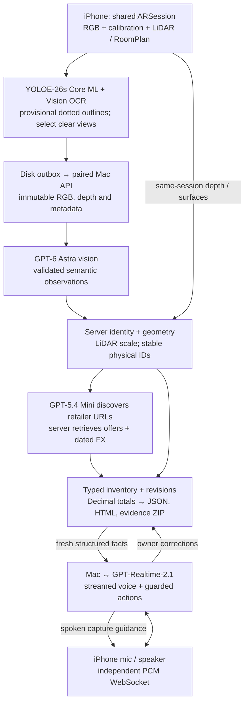

# Library Contents Claim Agent — architecture note

As built, 20 October 2026. One-page content summary; implementation detail and limitations are in the [technical report](submission/technical-report.md).

**Phone and server split.** The phone bundles YOLOE-26s prompt-free, INT8 Core ML: 4,585 model-native labels, full image plus two detail crops. It supplies provisional object outlines, Apple Vision OCR, blur/exposure checks and view selection. Borders are dotted; masks are not displayed. Apple Foundation Models are not used by the active path. Selected original-size JPEGs, aligned depth/confidence, intrinsics and poses are retained in a retryable outbox. The Mac independently validates evidence, calls GPT-6 Astra for clear novel unresolved images, and owns accepted identities, measurements, pricing and totals. Local labels never establish a price or metric dimension.

**Voice, video and depth coordination.** A complete spoken setup readback, explicit confirmation and a separate readiness answer gate capture. Audio streams through the Mac to OpenAI Realtime independently of frame workers; input transcription supports transcripts and action guards. Playback acknowledgments make interruptions and setup gates reflect what was heard. Voice receives fresh structured inventory facts, not a second upload of each image. Same-session RoomPlan updates arrive at most every three seconds; final geometry follows RoomBuilder processing. Unknowns and unfinished work remain visible.

**Metric scale.** LiDAR supplies metres, calibrated rays supply image geometry, and one ARSession supplies their common coordinates. The server fits a local high-confidence depth plane and intersects the four spine-corner rays; opposite edge averages give height/thickness in centimetres. It unions captured floor polygons, sums gross wall polygons, and separately unions/clips openings and shelving on each wall. Furniture dimensions come from supported RoomPlan boxes. Missing/ambiguous depth stays unknown. Camera-only mode has no implemented metric reconstruction.

**Price provenance.** GPT-5.4 Mini discovers URLs. The server retrieves retailer pages and validates structured offers against identity, condition, stock, market and currency. Each accepted value has a URL, retrieval time and saved extraction evidence. Foreign fallback retains the original offer plus dated FX. Unknown prices are excluded; rare/signed books, original/unknown art and values above INR 10,000 equivalent require appraisal. Totals use `Decimal` in code.

**Bounds and evidence.** Active settings permit 20 vision attempts per sweep, six seconds apart; two frame workers and four pricing workers use separate bounded queues. SHA-256 receipts prevent changed retries; physical association uses session, depth, RoomPlan and verified image correspondence, never name equality alone. Revision checks reject stale prices. Billing/access failures stop further attempts; missing usage is uncosted. Keys stay on the Mac; demo LAN HTTP is unencrypted.

**Validation boundary.** Recorded evidence includes 362 passing Python tests and a saved-sweep repair from 87 to 76 item records, including four chair records to one. These do not establish physical count accuracy. Full assessment ground truth, complete retailer coverage and scored end-to-end timing remain unverified; the latest pricing attempt reported `credit_balance_exhausted`.
