# Request and response flows

As implemented on 20 October 2026. The diagrams trace source code; they are not evidence of successful live-provider calls or physical accuracy.

The FastAPI API, Realtime bridge, SweepRunner, vision/price workers, tracking/geometry and EvidenceStore execute in one server process. Localhost/LAN HTTP and WebSocket connect the phone; HTTPS/WSS connect external providers. There is no microservice bus, durable distributed worker or SSE endpoint in this implementation.

Solid arrows represent requests/internal calls, blue dashed arrows responses, and purple dotted arrows asynchronous events. Numbered arrows match the payload/result ledger. Optional and failure paths are explicitly labelled. A combined step can summarize several in-process calls; it does not invent a network hop.

[Download the flow atlas](../../output/pdf/service-flow-diagrams.pdf) · [Full report with these diagrams](../../output/pdf/technical-report.pdf)

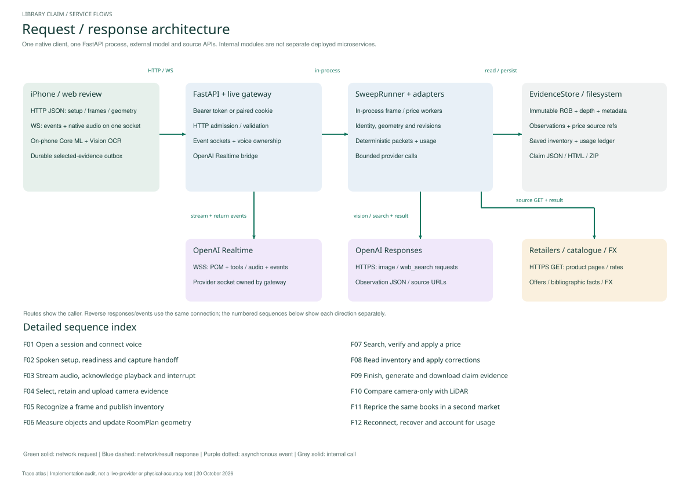

## F01 - Open a session and connect voice

HTTP creates setup state; the client WebSocket and provider WebSocket are separate connections.

[Editable Mermaid](flows/F01.mmd)

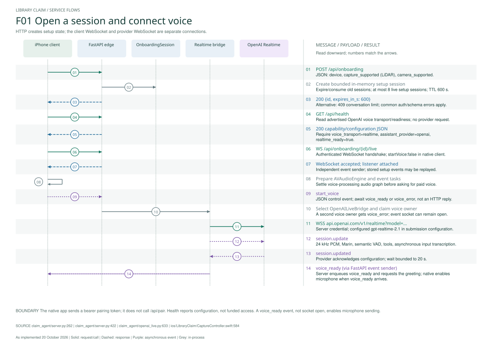

**Boundary:** The native app sends a bearer pairing token; it does not call /api/pair. Health reports configuration, not funded access. A voice_ready event, not socket open, enables microphone sending.

Sources: [claim_agent/server.py:262](https://github.com/Tushar-kalsi-virtualfusion/cozmo-library-claim-agent/blob/main/claim_agent/server.py#L262), [claim_agent/server.py:422](https://github.com/Tushar-kalsi-virtualfusion/cozmo-library-claim-agent/blob/main/claim_agent/server.py#L422), [claim_agent/openai_live.py:633](https://github.com/Tushar-kalsi-virtualfusion/cozmo-library-claim-agent/blob/main/claim_agent/openai_live.py#L633), [ios/LibraryClaim/CaptureController.swift:584](https://github.com/Tushar-kalsi-virtualfusion/cozmo-library-claim-agent/blob/main/ios/LibraryClaim/CaptureController.swift#L584)

## F02 - Spoken setup, readiness and capture handoff

Tool requests are provider events; the server validates them and changes setup state in process.

[Editable Mermaid](flows/F02.mmd)

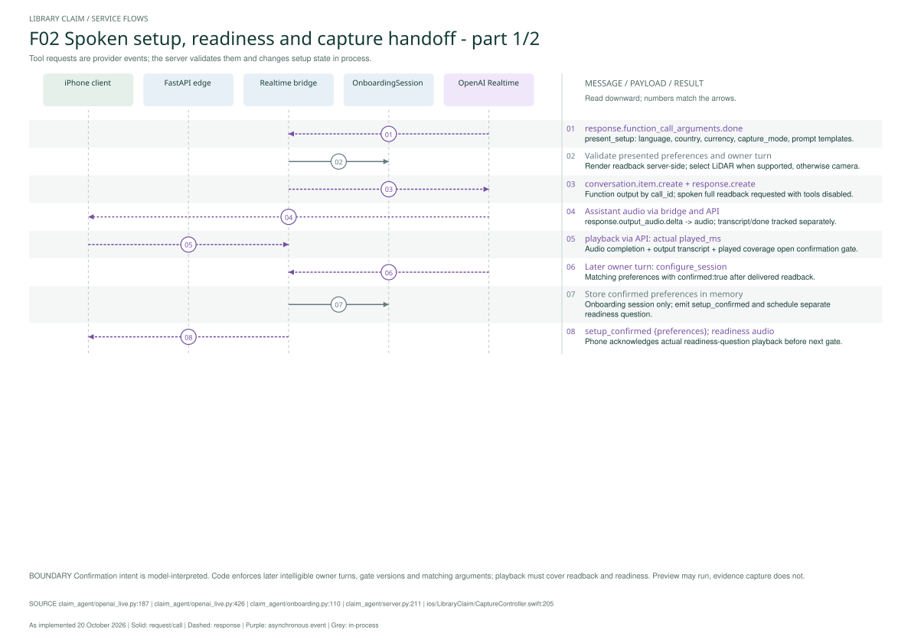

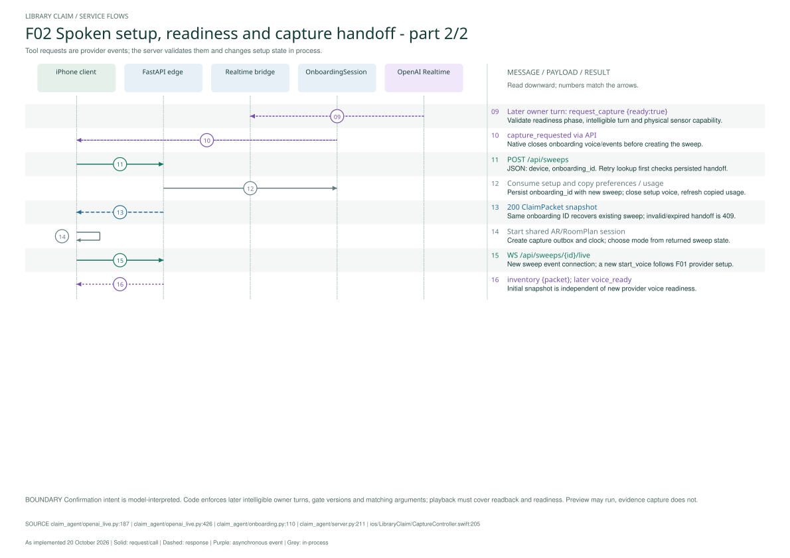

**Boundary:** Confirmation intent is model-interpreted. Code enforces later intelligible owner turns, gate versions and matching arguments; playback must cover readback and readiness. Preview may run, evidence capture does not.

Sources: [claim_agent/openai_live.py:187](https://github.com/Tushar-kalsi-virtualfusion/cozmo-library-claim-agent/blob/main/claim_agent/openai_live.py#L187), [claim_agent/openai_live.py:426](https://github.com/Tushar-kalsi-virtualfusion/cozmo-library-claim-agent/blob/main/claim_agent/openai_live.py#L426), [claim_agent/onboarding.py:110](https://github.com/Tushar-kalsi-virtualfusion/cozmo-library-claim-agent/blob/main/claim_agent/onboarding.py#L110), [claim_agent/server.py:211](https://github.com/Tushar-kalsi-virtualfusion/cozmo-library-claim-agent/blob/main/claim_agent/server.py#L211), [ios/LibraryClaim/CaptureController.swift:205](https://github.com/Tushar-kalsi-virtualfusion/cozmo-library-claim-agent/blob/main/ios/LibraryClaim/CaptureController.swift#L205)

## F03 - Stream audio, acknowledge playback and interrupt

Audio and transcript events stream asynchronously; generation completion does not prove playback.

[Editable Mermaid](flows/F03.mmd)

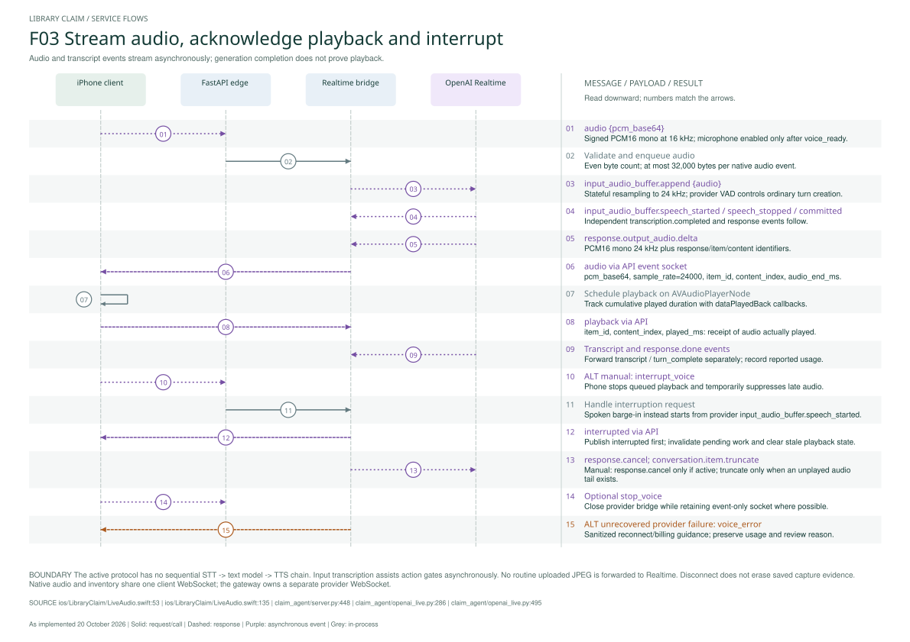

**Boundary:** The active protocol has no sequential STT -> text model -> TTS chain. Input transcription assists action gates asynchronously. No routine uploaded JPEG is forwarded to Realtime. Disconnect does not erase saved capture evidence. Native audio and inventory share one client WebSocket; the gateway owns a separate provider WebSocket.

Sources: [ios/LibraryClaim/LiveAudio.swift:53](https://github.com/Tushar-kalsi-virtualfusion/cozmo-library-claim-agent/blob/main/ios/LibraryClaim/LiveAudio.swift#L53), [ios/LibraryClaim/LiveAudio.swift:135](https://github.com/Tushar-kalsi-virtualfusion/cozmo-library-claim-agent/blob/main/ios/LibraryClaim/LiveAudio.swift#L135), [claim_agent/server.py:448](https://github.com/Tushar-kalsi-virtualfusion/cozmo-library-claim-agent/blob/main/claim_agent/server.py#L448), [claim_agent/openai_live.py:286](https://github.com/Tushar-kalsi-virtualfusion/cozmo-library-claim-agent/blob/main/claim_agent/openai_live.py#L286), [claim_agent/openai_live.py:495](https://github.com/Tushar-kalsi-virtualfusion/cozmo-library-claim-agent/blob/main/claim_agent/openai_live.py#L495)

## F04 - Select, retain and upload camera evidence

An HTTP receipt acknowledges immutable admission or suppression. Recognition completes later (F05).

[Editable Mermaid](flows/F04.mmd)

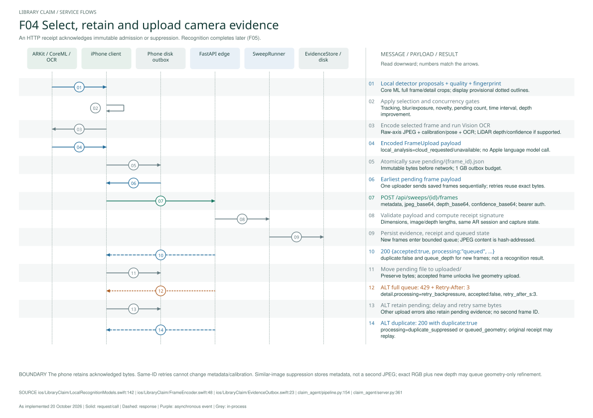

**Boundary:** The phone retains acknowledged bytes. Same-ID retries cannot change metadata/calibration. Similar-image suppression stores metadata, not a second JPEG; exact RGB plus new depth may queue geometry-only refinement.

Sources: [ios/LibraryClaim/LocalRecognitionModels.swift:142](https://github.com/Tushar-kalsi-virtualfusion/cozmo-library-claim-agent/blob/main/ios/LibraryClaim/LocalRecognitionModels.swift#L142), [ios/LibraryClaim/FrameEncoder.swift:48](https://github.com/Tushar-kalsi-virtualfusion/cozmo-library-claim-agent/blob/main/ios/LibraryClaim/FrameEncoder.swift#L48), [ios/LibraryClaim/EvidenceOutbox.swift:23](https://github.com/Tushar-kalsi-virtualfusion/cozmo-library-claim-agent/blob/main/ios/LibraryClaim/EvidenceOutbox.swift#L23), [claim_agent/pipeline.py:154](https://github.com/Tushar-kalsi-virtualfusion/cozmo-library-claim-agent/blob/main/claim_agent/pipeline.py#L154), [claim_agent/server.py:361](https://github.com/Tushar-kalsi-virtualfusion/cozmo-library-claim-agent/blob/main/claim_agent/server.py#L361)

## F05 - Recognize a frame and publish inventory

Frame workers run concurrently; publication order can differ from capture order.

[Editable Mermaid](flows/F05.mmd)

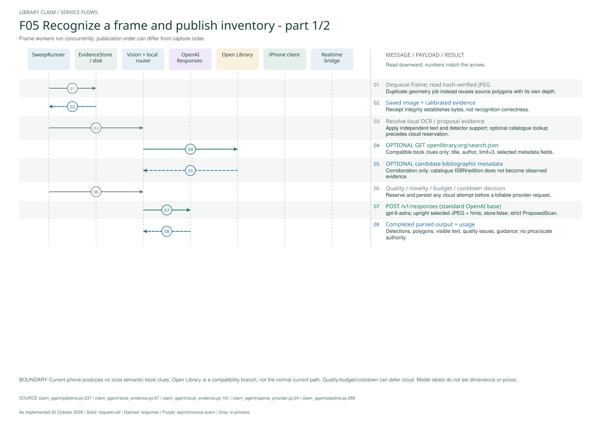

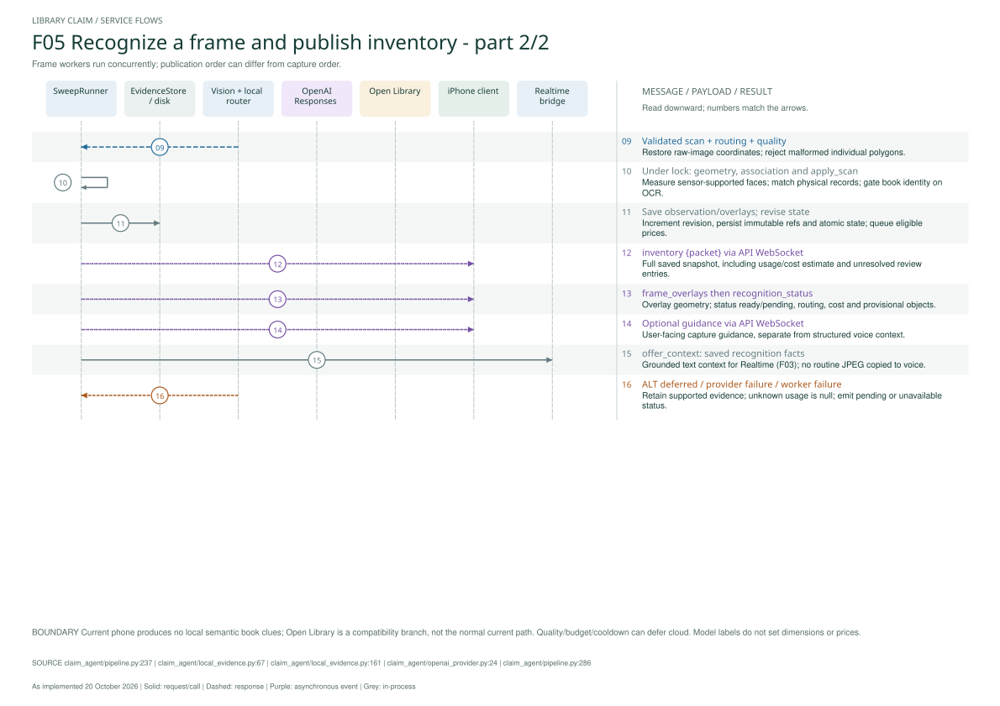

**Boundary:** Current phone produces no local semantic book clues; Open Library is a compatibility branch, not the normal current path. Quality/budget/cooldown can defer cloud. Model labels do not set dimensions or prices.

Sources: [claim_agent/pipeline.py:237](https://github.com/Tushar-kalsi-virtualfusion/cozmo-library-claim-agent/blob/main/claim_agent/pipeline.py#L237), [claim_agent/local_evidence.py:67](https://github.com/Tushar-kalsi-virtualfusion/cozmo-library-claim-agent/blob/main/claim_agent/local_evidence.py#L67), [claim_agent/local_evidence.py:161](https://github.com/Tushar-kalsi-virtualfusion/cozmo-library-claim-agent/blob/main/claim_agent/local_evidence.py#L161), [claim_agent/openai_provider.py:24](https://github.com/Tushar-kalsi-virtualfusion/cozmo-library-claim-agent/blob/main/claim_agent/openai_provider.py#L24), [claim_agent/pipeline.py:286](https://github.com/Tushar-kalsi-virtualfusion/cozmo-library-claim-agent/blob/main/claim_agent/pipeline.py#L286)

## F06 - Measure objects and update RoomPlan geometry

Object face measurements and room/furniture geometry use calibrated sensor evidence, not guessed model scale.

[Editable Mermaid](flows/F06.mmd)

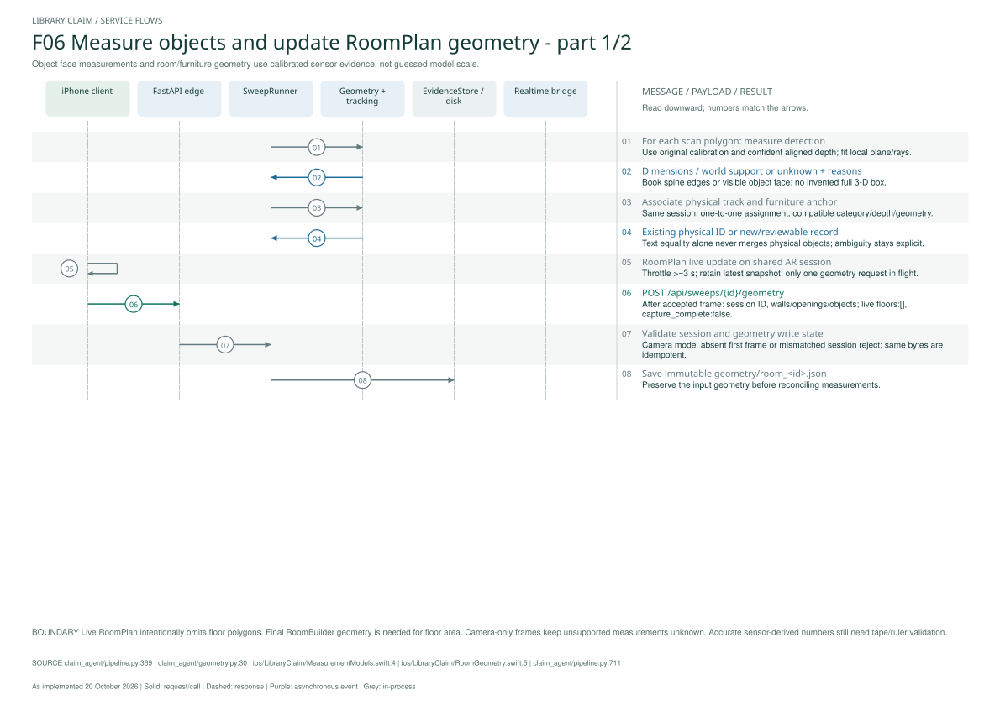

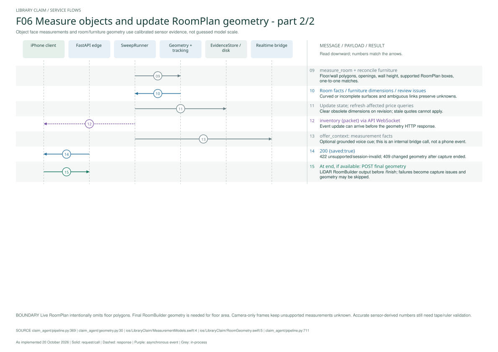

**Boundary:** Live RoomPlan intentionally omits floor polygons. Final RoomBuilder geometry is needed for floor area. Camera-only frames keep unsupported measurements unknown. Accurate sensor-derived numbers still need tape/ruler validation.

Sources: [claim_agent/pipeline.py:369](https://github.com/Tushar-kalsi-virtualfusion/cozmo-library-claim-agent/blob/main/claim_agent/pipeline.py#L369), [claim_agent/geometry.py:30](https://github.com/Tushar-kalsi-virtualfusion/cozmo-library-claim-agent/blob/main/claim_agent/geometry.py#L30), [ios/LibraryClaim/MeasurementModels.swift:4](https://github.com/Tushar-kalsi-virtualfusion/cozmo-library-claim-agent/blob/main/ios/LibraryClaim/MeasurementModels.swift#L4), [ios/LibraryClaim/RoomGeometry.swift:5](https://github.com/Tushar-kalsi-virtualfusion/cozmo-library-claim-agent/blob/main/ios/LibraryClaim/RoomGeometry.swift#L5), [claim_agent/pipeline.py:711](https://github.com/Tushar-kalsi-virtualfusion/cozmo-library-claim-agent/blob/main/claim_agent/pipeline.py#L711)

## F07 - Search, verify and apply a price

Pricing is a separate in-process queue. Search returns URLs; fetched source offers establish price evidence.

[Editable Mermaid](flows/F07.mmd)

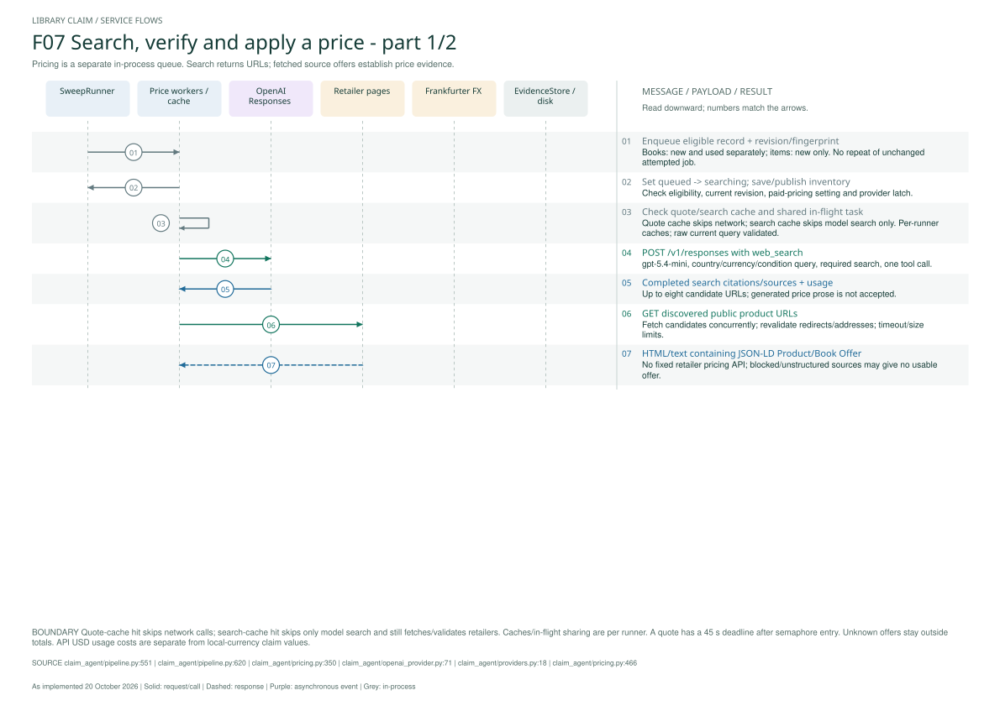

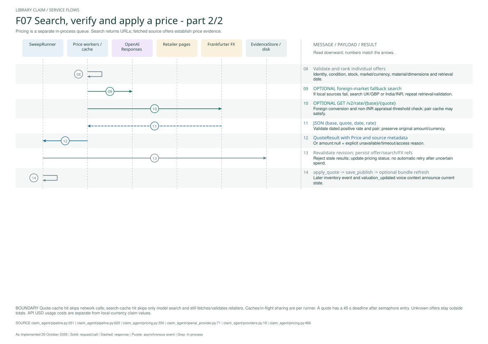

**Boundary:** Quote-cache hit skips network calls; search-cache hit skips only model search and still fetches/validates retailers. Caches/in-flight sharing are per runner. A quote has a 45 s deadline after semaphore entry. Unknown offers stay outside totals. API USD usage costs are separate from local-currency claim values.

Sources: [claim_agent/pipeline.py:551](https://github.com/Tushar-kalsi-virtualfusion/cozmo-library-claim-agent/blob/main/claim_agent/pipeline.py#L551), [claim_agent/pipeline.py:620](https://github.com/Tushar-kalsi-virtualfusion/cozmo-library-claim-agent/blob/main/claim_agent/pipeline.py#L620), [claim_agent/pricing.py:350](https://github.com/Tushar-kalsi-virtualfusion/cozmo-library-claim-agent/blob/main/claim_agent/pricing.py#L350), [claim_agent/openai_provider.py:71](https://github.com/Tushar-kalsi-virtualfusion/cozmo-library-claim-agent/blob/main/claim_agent/openai_provider.py#L71), [claim_agent/providers.py:18](https://github.com/Tushar-kalsi-virtualfusion/cozmo-library-claim-agent/blob/main/claim_agent/providers.py#L18), [claim_agent/pricing.py:466](https://github.com/Tushar-kalsi-virtualfusion/cozmo-library-claim-agent/blob/main/claim_agent/pricing.py#L466)

## F08 - Read inventory and apply corrections

Browser review pairs with a cookie; native HTTP uses a bearer token. Both can subscribe to the same event route.

[Editable Mermaid](flows/F08.mmd)

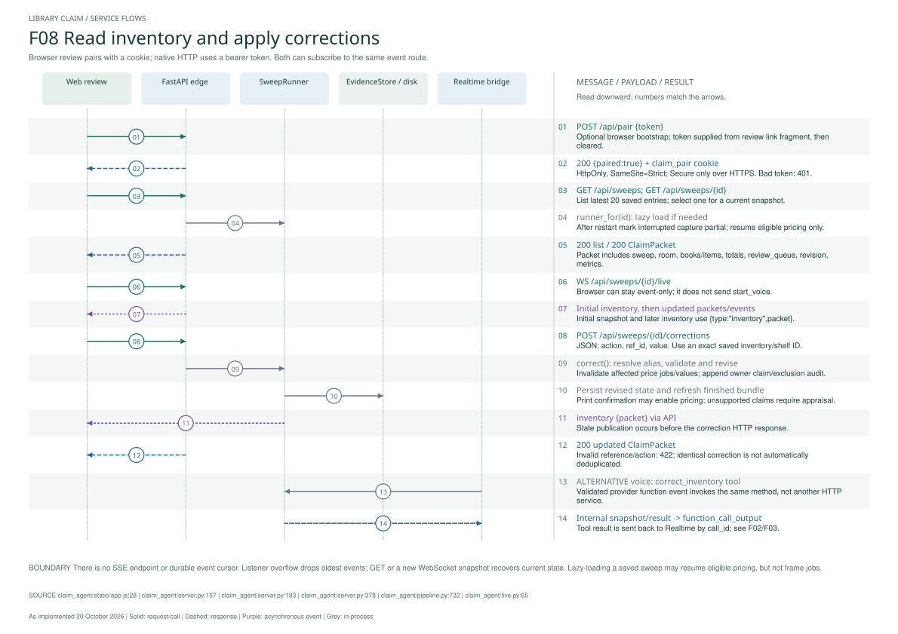

**Boundary:** There is no SSE endpoint or durable event cursor. Listener overflow drops oldest events; GET or a new WebSocket snapshot recovers current state. Lazy-loading a saved sweep may resume eligible pricing, but not frame jobs.

Sources: [claim_agent/static/app.js:28](https://github.com/Tushar-kalsi-virtualfusion/cozmo-library-claim-agent/blob/main/claim_agent/static/app.js#L28), [claim_agent/server.py:157](https://github.com/Tushar-kalsi-virtualfusion/cozmo-library-claim-agent/blob/main/claim_agent/server.py#L157), [claim_agent/server.py:193](https://github.com/Tushar-kalsi-virtualfusion/cozmo-library-claim-agent/blob/main/claim_agent/server.py#L193), [claim_agent/server.py:378](https://github.com/Tushar-kalsi-virtualfusion/cozmo-library-claim-agent/blob/main/claim_agent/server.py#L378), [claim_agent/pipeline.py:732](https://github.com/Tushar-kalsi-virtualfusion/cozmo-library-claim-agent/blob/main/claim_agent/pipeline.py#L732), [claim_agent/live.py:65](https://github.com/Tushar-kalsi-virtualfusion/cozmo-library-claim-agent/blob/main/claim_agent/live.py#L65)

## F09 - Finish, generate and download claim evidence

The native client flushes saved evidence and final geometry before a held /finish request.

[Editable Mermaid](flows/F09.mmd)

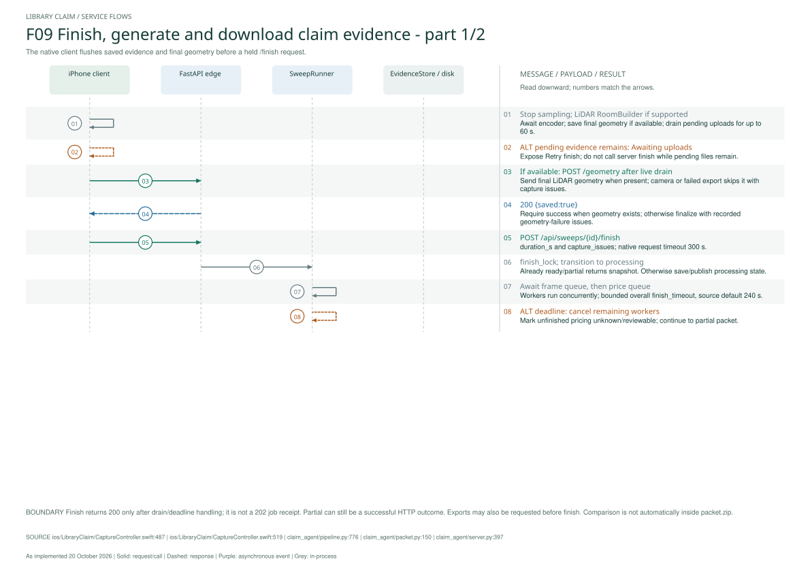

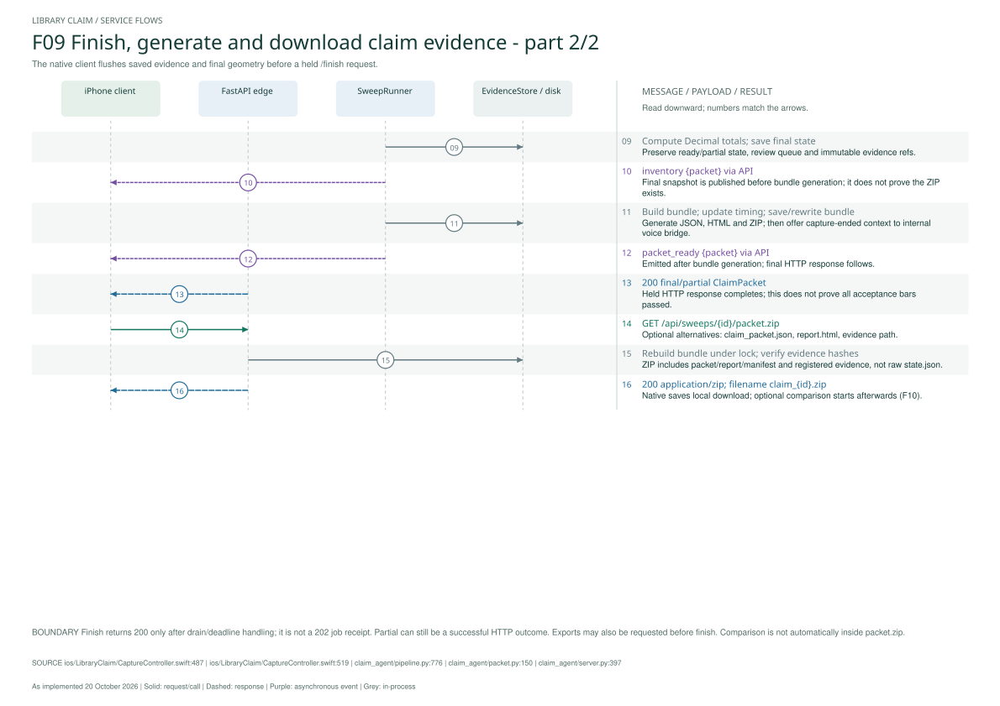

**Boundary:** Finish returns 200 only after drain/deadline handling; it is not a 202 job receipt. Partial can still be a successful HTTP outcome. Exports may also be requested before finish. Comparison is not automatically inside packet.zip.

Sources: [ios/LibraryClaim/CaptureController.swift:487](https://github.com/Tushar-kalsi-virtualfusion/cozmo-library-claim-agent/blob/main/ios/LibraryClaim/CaptureController.swift#L487), [ios/LibraryClaim/CaptureController.swift:519](https://github.com/Tushar-kalsi-virtualfusion/cozmo-library-claim-agent/blob/main/ios/LibraryClaim/CaptureController.swift#L519), [claim_agent/pipeline.py:776](https://github.com/Tushar-kalsi-virtualfusion/cozmo-library-claim-agent/blob/main/claim_agent/pipeline.py#L776), [claim_agent/packet.py:150](https://github.com/Tushar-kalsi-virtualfusion/cozmo-library-claim-agent/blob/main/claim_agent/packet.py#L150), [claim_agent/server.py:397](https://github.com/Tushar-kalsi-virtualfusion/cozmo-library-claim-agent/blob/main/claim_agent/server.py#L397)

## F10 - Compare camera-only with LiDAR

Optional same-frame depth ablation: one held POST, persisted status reads, and a separate replay runner.

[Editable Mermaid](flows/F10.mmd)

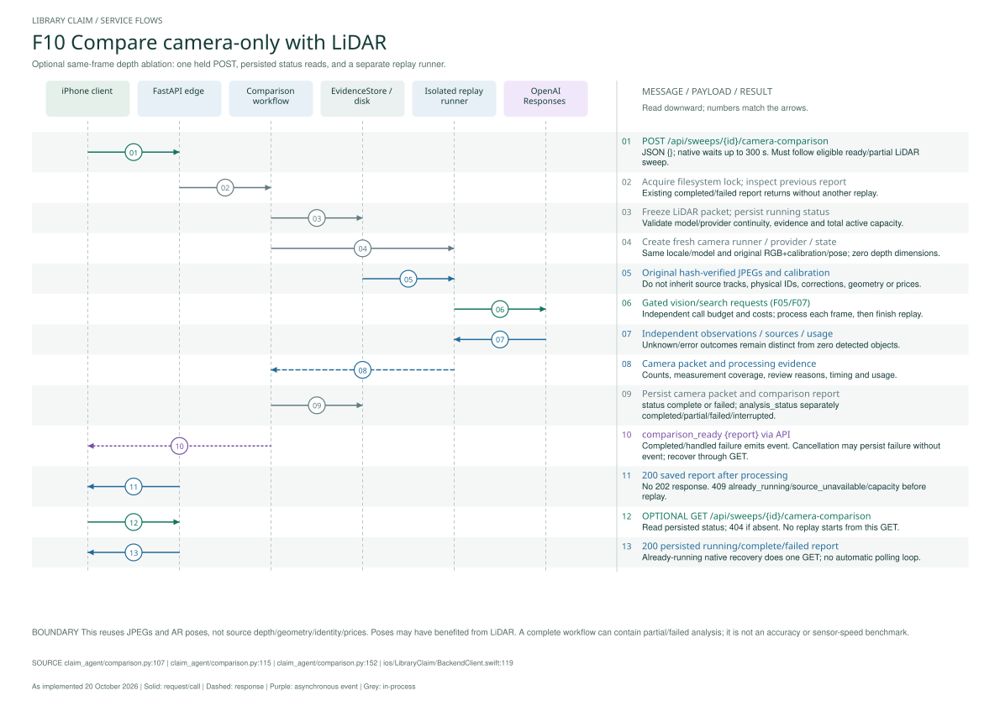

**Boundary:** This reuses JPEGs and AR poses, not source depth/geometry/identity/prices. Poses may have benefited from LiDAR. A complete workflow can contain partial/failed analysis; it is not an accuracy or sensor-speed benchmark.

Sources: [claim_agent/comparison.py:107](https://github.com/Tushar-kalsi-virtualfusion/cozmo-library-claim-agent/blob/main/claim_agent/comparison.py#L107), [claim_agent/comparison.py:115](https://github.com/Tushar-kalsi-virtualfusion/cozmo-library-claim-agent/blob/main/claim_agent/comparison.py#L115), [claim_agent/comparison.py:152](https://github.com/Tushar-kalsi-virtualfusion/cozmo-library-claim-agent/blob/main/claim_agent/comparison.py#L152), [ios/LibraryClaim/BackendClient.swift:119](https://github.com/Tushar-kalsi-virtualfusion/cozmo-library-claim-agent/blob/main/ios/LibraryClaim/BackendClient.swift#L119)

## F11 - Reprice the same books in a second market

Two entry points share one method: voice emits a result event; direct HTTP returns the result without that event.

[Editable Mermaid](flows/F11.mmd)

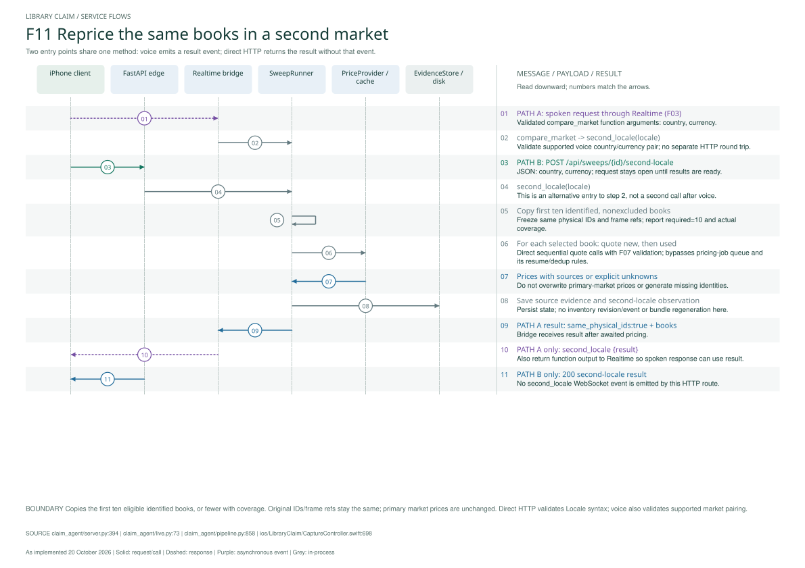

**Boundary:** Copies the first ten eligible identified books, or fewer with coverage. Original IDs/frame refs stay the same; primary market prices are unchanged. Direct HTTP validates Locale syntax; voice also validates supported market pairing.

Sources: [claim_agent/server.py:394](https://github.com/Tushar-kalsi-virtualfusion/cozmo-library-claim-agent/blob/main/claim_agent/server.py#L394), [claim_agent/live.py:73](https://github.com/Tushar-kalsi-virtualfusion/cozmo-library-claim-agent/blob/main/claim_agent/live.py#L73), [claim_agent/pipeline.py:858](https://github.com/Tushar-kalsi-virtualfusion/cozmo-library-claim-agent/blob/main/claim_agent/pipeline.py#L858), [ios/LibraryClaim/CaptureController.swift:698](https://github.com/Tushar-kalsi-virtualfusion/cozmo-library-claim-agent/blob/main/ios/LibraryClaim/CaptureController.swift#L698)

## F12 - Reconnect, recover and account for usage

Recovery is bounded and explicit. Files are durable; provider sessions and most processing queues are not.

[Editable Mermaid](flows/F12.mmd)

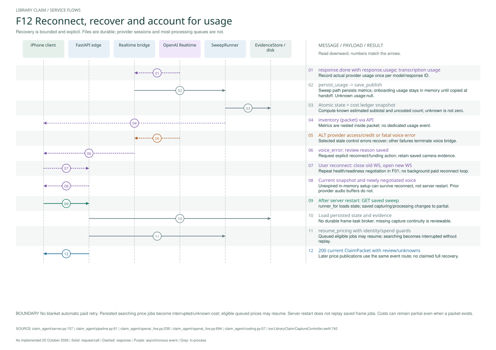

**Boundary:** No blanket automatic paid retry. Persisted searching price jobs become interrupted/unknown-cost; eligible queued prices may resume. Server restart does not replay saved frame jobs. Costs can remain partial even when a packet exists.

Sources: [claim_agent/server.py:157](https://github.com/Tushar-kalsi-virtualfusion/cozmo-library-claim-agent/blob/main/claim_agent/server.py#L157), [claim_agent/pipeline.py:61](https://github.com/Tushar-kalsi-virtualfusion/cozmo-library-claim-agent/blob/main/claim_agent/pipeline.py#L61), [claim_agent/openai_live.py:238](https://github.com/Tushar-kalsi-virtualfusion/cozmo-library-claim-agent/blob/main/claim_agent/openai_live.py#L238), [claim_agent/openai_live.py:694](https://github.com/Tushar-kalsi-virtualfusion/cozmo-library-claim-agent/blob/main/claim_agent/openai_live.py#L694), [claim_agent/costing.py:57](https://github.com/Tushar-kalsi-virtualfusion/cozmo-library-claim-agent/blob/main/claim_agent/costing.py#L57), [ios/LibraryClaim/CaptureController.swift:742](https://github.com/Tushar-kalsi-virtualfusion/cozmo-library-claim-agent/blob/main/ios/LibraryClaim/CaptureController.swift#L742)

## HTTP and WebSocket index

| Method | Route | Result / transport | Purpose / flow |
|---|---|---|---|
| GET | /api/health | 200 configuration JSON | F01; unauthenticated; no paid readiness probe |
| POST | /api/pair | 200 {paired:true}; cookie | F08 browser-only pairing; 401 for bad token |
| POST | /api/onboarding | 200 {id,expires_in_s}; 409 capacity | F01; JSON device/capture_supported/camera_supported |
| WS | /api/onboarding/{id}/live | Accepted + async setup/audio events | F01-F03; 4401/4404 are pre-accept rejection branches |
| POST | /api/sweeps | 200 ClaimPacket; 409 invalid handoff | F02; native {device,onboarding_id}; retry reuses saved handoff |
| GET | /api/sweeps | 200 summary array, latest 20 | F08; reads state files, does not instantiate runners |
| GET | /api/sweeps/{id} | 200 current ClaimPacket | F08/F12; lazy load may resume eligible pricing |
| WS | /api/sweeps/{id}/live | Initial inventory; async events | F03/F05/F08; no SSE; voice optional on this socket |
| POST | /api/sweeps/{id}/frames | 200 receipt / 429 backpressure | F04; metadata + JPEG/depth/confidence base64; result later via WS |
| POST | /api/sweeps/{id}/geometry | 200 {saved:true} | F06; same-session geometry; invalid/session errors 422 |
| POST | /api/sweeps/{id}/corrections | 200 updated ClaimPacket | F08; {action,ref_id,value}; inventory published before response |
| POST | /api/sweeps/{id}/finish | 200 ready/partial ClaimPacket | F09; held request, not 202; duration_s/capture_issues |
| POST | /api/sweeps/{id}/second-locale | 200 comparison result | F11; held request; does not itself emit second_locale event |
| GET | /api/sweeps/{id}/camera-comparison | 200 persisted report; 404 absent | F10; reads running/complete/failed; does not start replay |
| POST | /api/sweeps/{id}/camera-comparison | 200 report; 409 conflict/capacity | F10; held request; reuses saved result without extra replay |
| GET | /api/sweeps/{id}/packet.zip | 200 application/zip attachment | F09; rebuild current bundle; not gated on finished state |
| GET | /api/sweeps/{id}/claim_packet.json | 200 current ClaimPacket JSON | F09; computed snapshot rather than reading stored file |
| GET | /api/sweeps/{id}/report.html | 200 text/html | F09; regenerate bundle then serve readable report |
| GET | /api/sweeps/{id}/{kind}/{name} | 200 JPEG or octet-stream | F09; allowlisted path and saved SHA-256 validation |
| GET/POST | /api/{onboarding|sweeps}/{id}/local-voice | Legacy context / tool contract | Inactive native path; do not confuse with OpenAI Realtime |
| POST | /api/{onboarding|sweeps}/{id}/local-voice/assistant | Legacy text assistant contract | Inactive native path; historical provider adapters remain |
| POST | /api/{onboarding|sweeps}/{id}/local-voice/{transcribe|speech} | Legacy speech HTTP contracts | Inactive native path; no active sequential STT/TTS chain |
| POST | /api/sweeps/{id}/local-voice/guidance | Legacy spoken-guidance contract | Inactive native path; current bridge uses Realtime context |
| WSS | api.openai.com/v1/realtime?model=... | session/audio/transcript/tool/usage events | F01-F03; server credential; independent upstream socket |
| POST | api.openai.com/v1/responses | Structured scan or search URLs + usage | F05/F07; standard SDK base, configurable; store:false |
| GET | Discovered public retailer product URL | HTML/text with JSON-LD offers | F07; credential-free retrieval; redirect/address validation |
| GET | api.frankfurter.dev/v2/rate/{base}/{quote} | JSON pair/date/rate | F07; conversion and appraisal threshold; optional/cacheable |
| GET | openlibrary.org/search.json | Candidate bibliographic metadata | F05 compatibility branch; not normal current-phone path |
