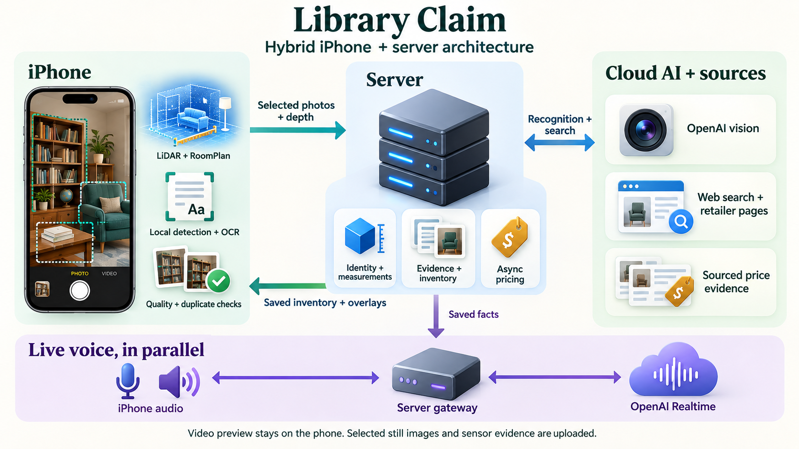

# Illustrated architecture overview

This additional icon-based illustration summarizes the implemented system. Its
phone screen is a conceptual illustration, not a captured app screenshot or
accuracy evidence. The [one-page technical architecture](../../output/pdf/architecture-note.pdf)
and [full technical report](../../output/pdf/technical-report.pdf) define the
precise model responsibilities, geometry checks and limitations.

- **iPhone:** provisional YOLOE Core ML proposals, Vision OCR, selected photos, LiDAR depth and RoomPlan geometry. Local predictions do not establish inventory identity or price.
- **Server:** validates observations, associates physical identities, calculates supported measurements, keeps evidence and coordinates asynchronous valuations.
- **Cloud and web:** OpenAI vision interprets selected images; web search finds retailer pages; server code validates retrieved offers and computes totals.
- **Voice:** iPhone audio passes through the server gateway to OpenAI Realtime independently of recognition and pricing. Saved inventory facts ground spoken guidance.

Continuous preview remains on the phone; selected stills and calibrated sensor
evidence are uploaded. The image uses a generic price-tag symbol, not a statement
that every valuation is in dollars. The selected market controls currency.

Created with the built-in image-generation tool. The [generation prompt](assets/architecture-icons.prompt.txt)
is retained for reproducibility; this is a communication asset, not generated
claim evidence. The supplied demonstration videos remain unchanged.
